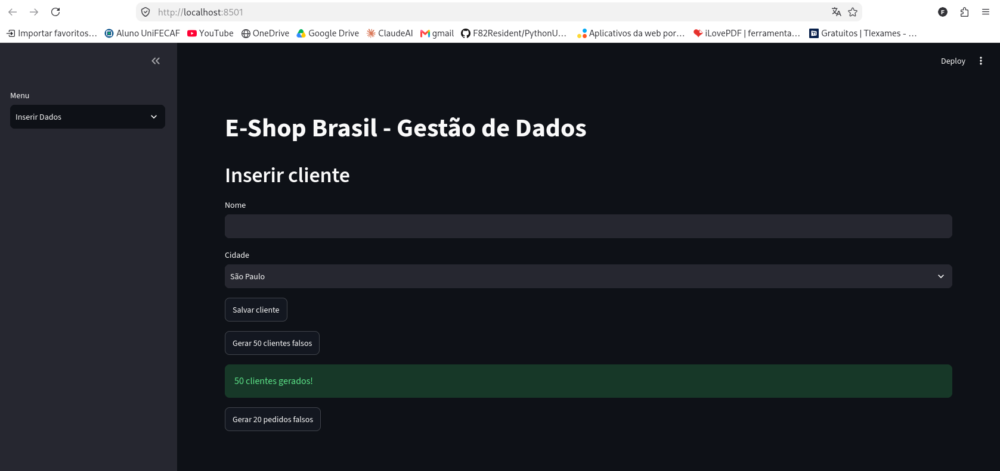
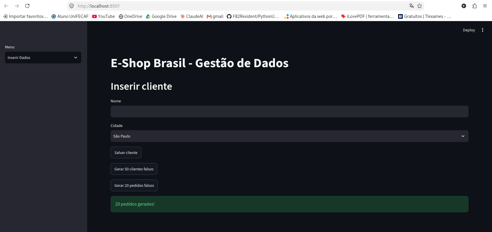
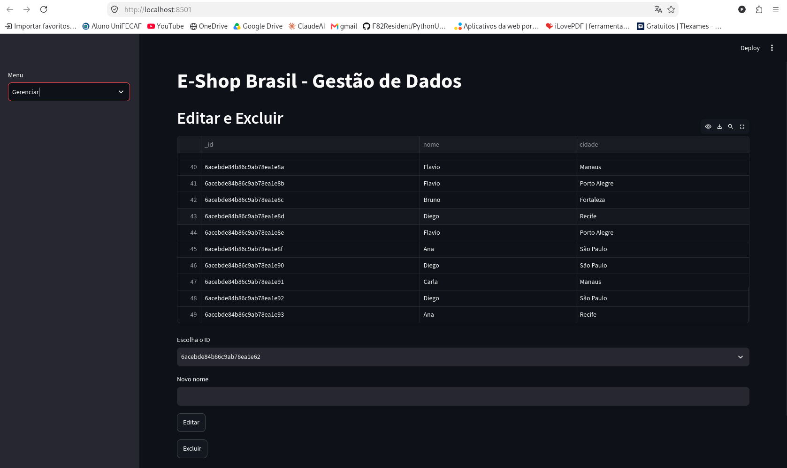
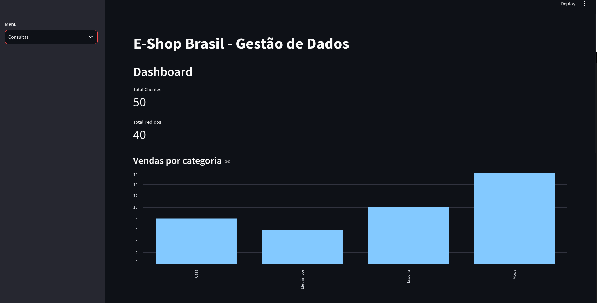
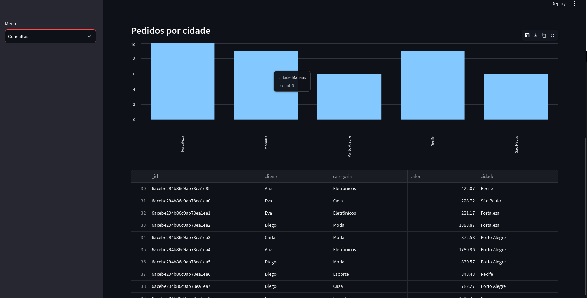
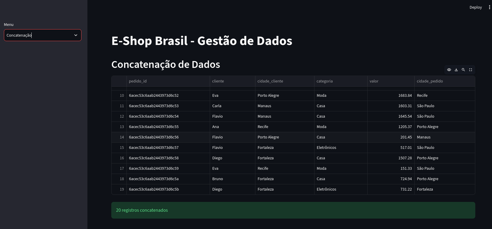

# E-Shop Brasil - Gestão de Dados com MongoDB e Streamlit

**Disciplina:** Advanced Databases and Big Data
**Aluno:** Flavio Costa do Carmo - RA 188401 - Tecnologia em Gestão de TI

---

## 1. Introdução

A **E-Shop Brasil** é uma plataforma de comércio eletrônico de grande porte, com mais de 5 milhões de clientes ativos e cerca de 100 mil pedidos por dia. Com esse volume, a empresa enfrenta desafios de **gestão de dados** (segurança, privacidade e personalização) e de **otimização logística**.

### Objetivo

Este projeto simula, em pequena escala, o papel da equipe de TI da E-Shop Brasil. Ele constrói uma aplicação funcional que:

- armazena dados de clientes e pedidos em um banco **NoSQL (MongoDB)**;
- permite inserir, editar, excluir e consultar esses dados por uma interface web;
- cruza (concatena) dados de pedidos e clientes;
- exibe indicadores em gráficos, como apoio às áreas de marketing, vendas e operações.

> Os dados são **fictícios**, gerados pela própria aplicação. Nenhum dado real de cliente é usado.

---

## 2. Tecnologias utilizadas

| Tecnologia | Para que serve no projeto |
|---|---|
| **Docker / Docker Compose** | Empacota e sobe todo o ambiente com um único comando, de forma reproduzível. |
| **MongoDB 7** | Banco NoSQL orientado a documentos. É flexível para dados semiestruturados e escala horizontalmente. |
| **Streamlit** | Cria a interface web em Python, com formulários, tabelas e gráficos. |
| **PyMongo** | Conecta o Python ao MongoDB. |
| **Pandas** | Organiza os dados em tabelas (DataFrames) para exibição e gráficos. |
| **Python 3.11** | Linguagem da aplicação. |

---

## 3. Descrição da aplicação

O banco se chama `eshop_brasil` e tem duas coleções: `clientes` e `pedidos`. A interface tem quatro menus na barra lateral.

### 3.1 Inserir Dados (inserção no MongoDB)
- Cadastro manual de um cliente (nome e cidade).
- Botão **Gerar 50 clientes falsos**.
- Botão **Gerar 20 pedidos falsos**, com cliente, categoria, valor e cidade.

### 3.2 Gerenciar (edição e exclusão)
- Lista os clientes cadastrados em uma tabela.
- Permite escolher um cliente pelo `_id` para **editar o nome** ou **excluí-lo**.

### 3.3 Consultas (consultas e exibição gráfica)
- Métricas: total de clientes e total de pedidos.
- Gráfico de **vendas por categoria**.
- Gráfico de **pedidos por cidade**.
- Tabela com os 10 últimos pedidos.

### 3.4 Concatenação (manipulação e junção de dados)
- Cada pedido guarda o `cliente_id` (o `_id` de um cliente existente).
- A aplicação cruza `pedidos` e `clientes` com o operador `$lookup` do MongoDB, que equivale a um *join* do SQL, usando `pedidos.cliente_id = clientes._id`. Assim, cada pedido se liga a **um único** cliente.
- Os operadores `$unwind` e `$project` deixam a tabela final legível: pedido, cliente, cidade do cliente, categoria, valor e cidade do pedido.
- Mostra o resultado em uma tabela e informa o total de registros concatenados.

---

## 4. Comandos para execução

### Pré-requisitos
- [Docker](https://docs.docker.com/get-docker/) e Docker Compose instalados.

### Opção A: `docker-compose` (recomendada)

```bash
git clone https://github.com/F82Resident/eshop-brasil.git
cd eshop-brasil
docker-compose up --build
```

Depois, abra no navegador: **http://localhost:8501**

Para parar o ambiente:

```bash
docker-compose down
```

Os dados ficam salvos no volume `mongo_data`. Para apagá-los também, use `docker-compose down -v`.

### Opção B: `docker build` + `docker run`

```bash
docker network create eshop-net
docker run -d --name mongo --network eshop-net -p 27017:27017 mongo:7
docker build -t eshop-streamlit .
docker run -p 8501:8501 --network eshop-net -e MONGO_URI=mongodb://mongo:27017/ eshop-streamlit
```

### Opção C: executar o `app.py` direto no Streamlit (sem Docker para o app)

É necessário ter um MongoDB rodando em `localhost:27017`.

```bash
pip install -r requirements.txt
streamlit run app.py
```

---

## 5. Testes e exemplos

As imagens abaixo mostram o funcionamento de cada menu. Elas ficam na pasta [`exemplos/`](exemplos/).

### Inserir Dados
Geração de 50 clientes falsos:



Geração de 20 pedidos falsos:



### Gerenciar (editar e excluir)


### Consultas (dashboard)
Métricas e vendas por categoria:



Pedidos por cidade e tabela dos últimos pedidos:



### Concatenação


### Roteiro de teste manual

1. Abra **Inserir Dados** e clique em *Gerar 50 clientes falsos* e *Gerar 20 pedidos falsos*.
2. Em **Gerenciar**, escolha um cliente, digite um novo nome e clique em *Editar*. Depois teste *Excluir*.
3. Em **Consultas**, confira as métricas e os gráficos.
4. Em **Concatenação**, confira a tabela com os dados cruzados.

---

## Estrutura do repositório

```
├── README.md
├── Dockerfile
├── docker-compose.yml
├── requirements.txt
├── app.py
└── exemplos/        (prints do funcionamento)
```

## Vídeo Pitch

🎥 Link do vídeo: _(adicionar link do YouTube não listado)_